# Estudio Lasalle

Marketing site for Estudio Jurídico Lasalle, a law firm in Zona Norte, Buenos Aires. Content is in Spanish.

Built with Astro 5, React 19, Tailwind CSS 4 and shadcn/ui, in a Turborepo + pnpm monorepo.

## Screenshots

| Light | Dark |
| --- | --- |
| 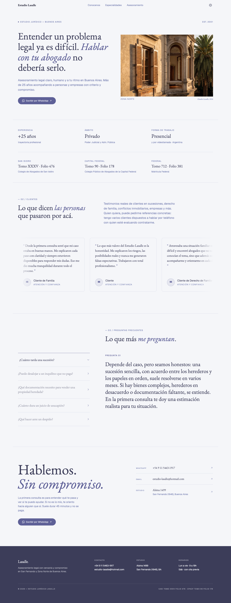 | 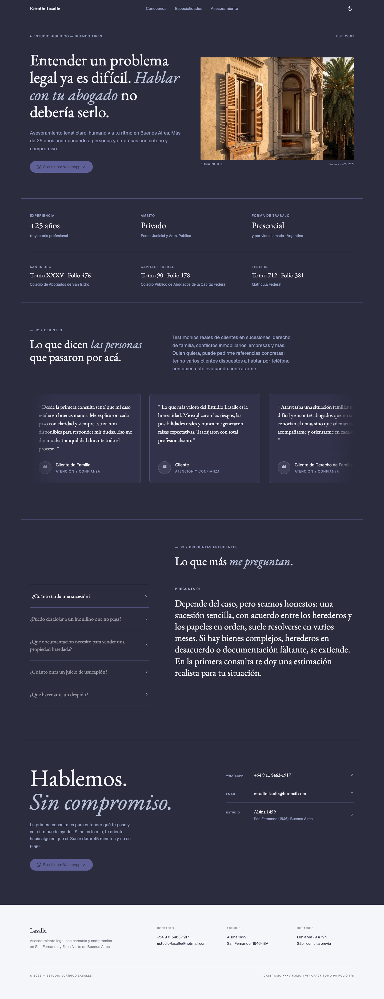 |

<details>
<summary>More pages</summary>

| Page | Light | Dark |
| --- | --- | --- |
| Specialties | 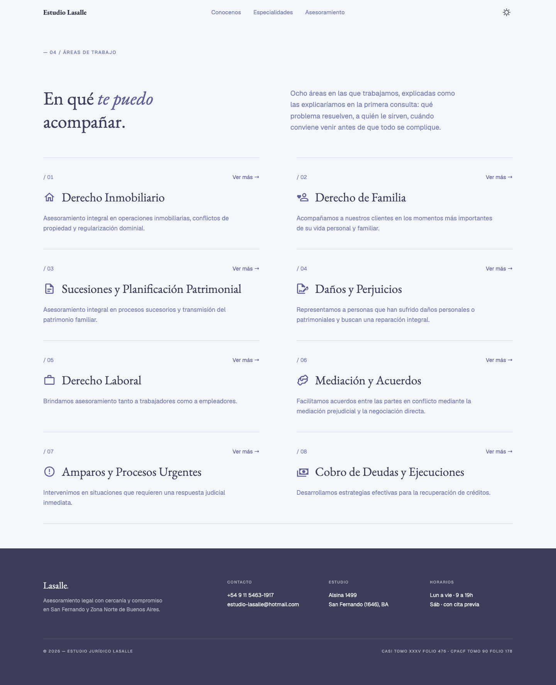 | 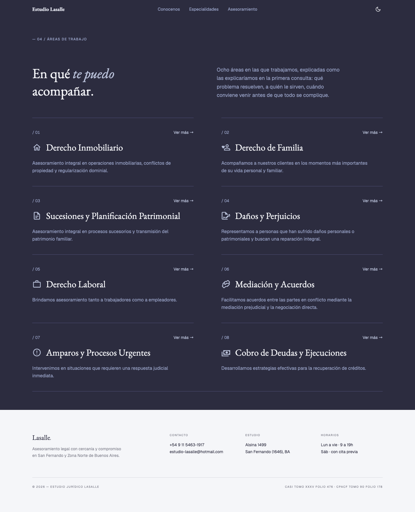 |
| Specialty detail | 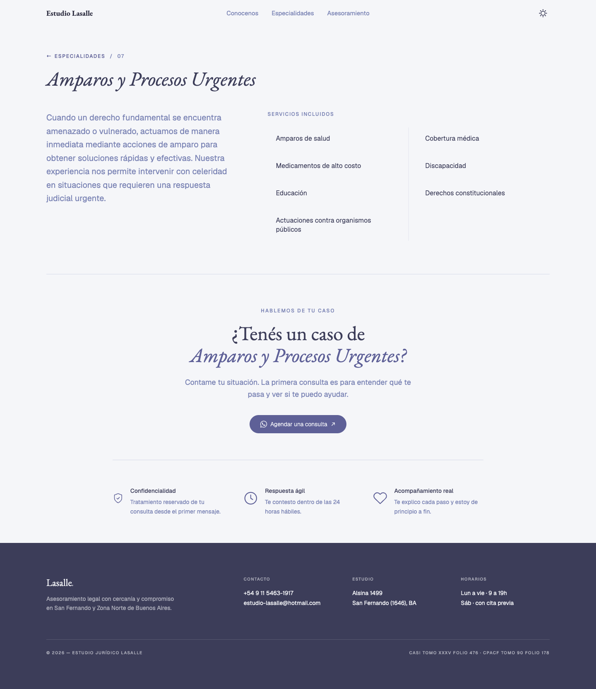 | 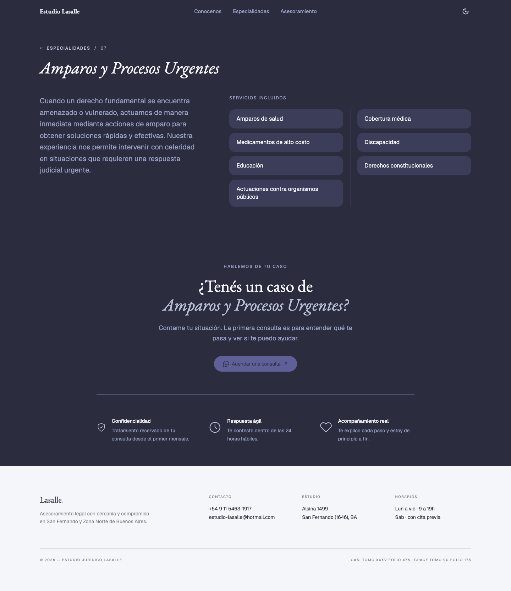 |
| Advisory plans | 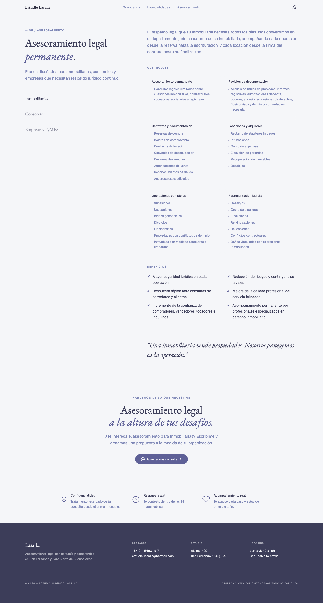 | 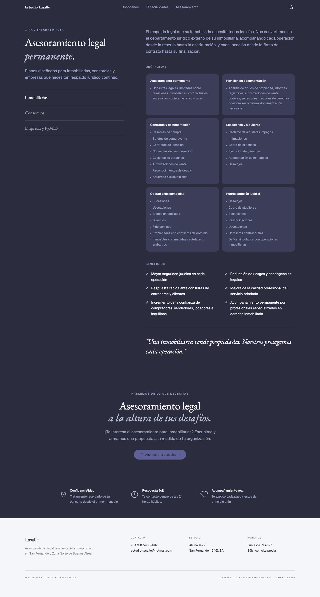 |
| Success stories | 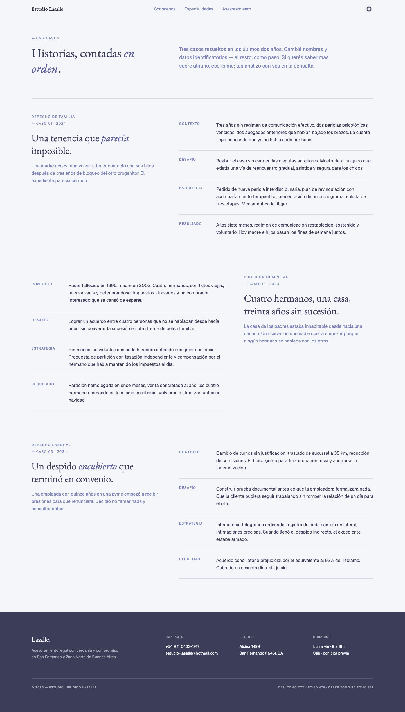 | 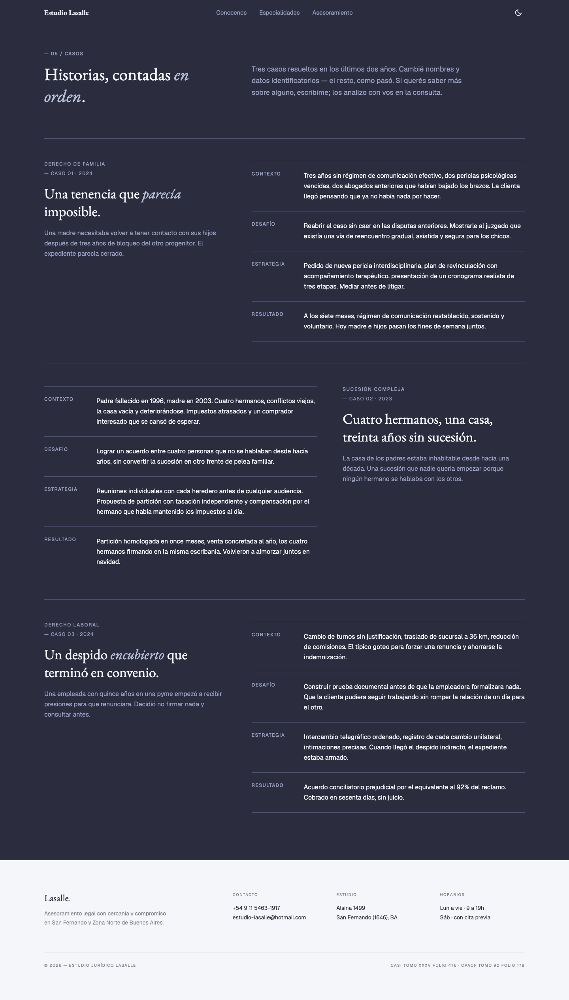 |
| About | 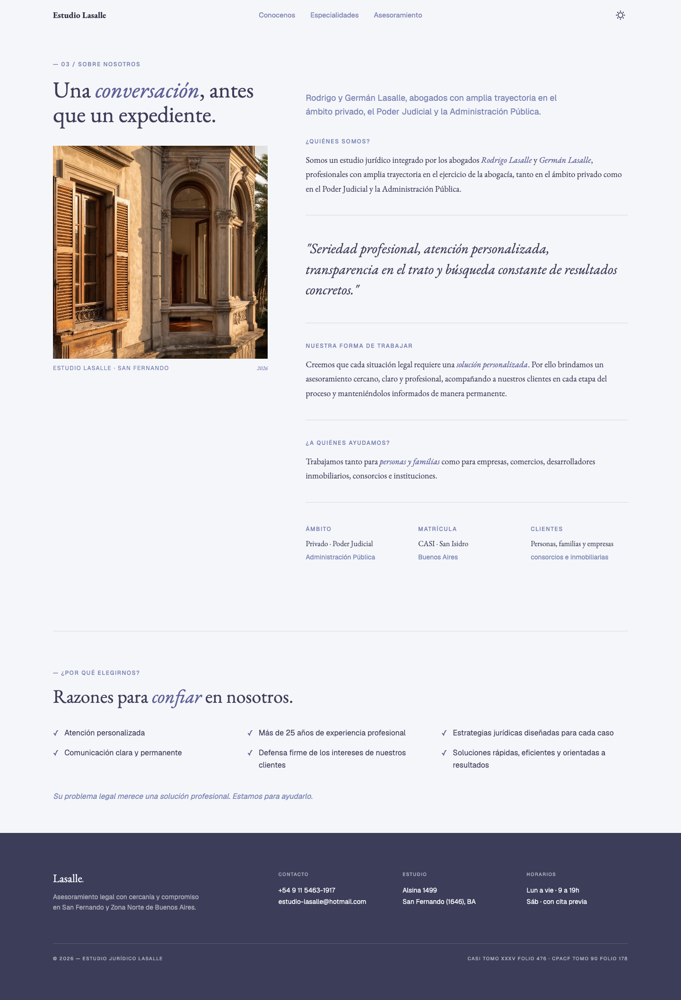 | 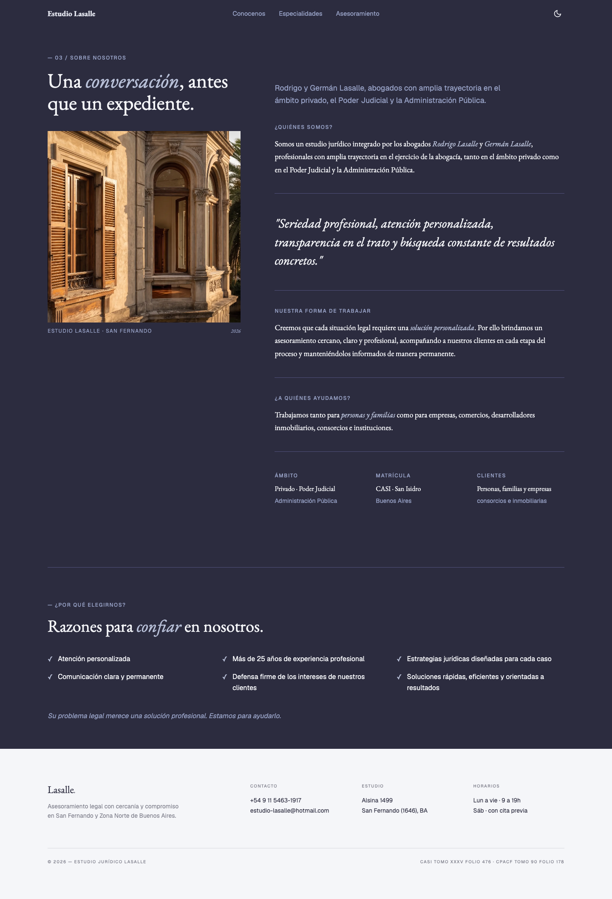 |

Mobile (390px):

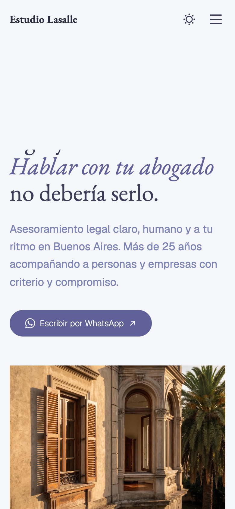

</details>

## Routes

| Route | Description |
| --- | --- |
| `/` | Hero, testimonials, FAQ and contact |
| `/conocenos` | About the firm |
| `/especialidades` | Practice areas |
| `/especialidades/[slug]` | One page per practice area |
| `/asesoramiento` | Advisory plans, with tabs |
| `/casos-de-exito` | Success stories |

## Structure

- `apps/web`: Astro site (pages, components, content in `src/const.ts`)
- `packages/ui`: shared UI, theme tokens and global styles (`src/styles/globals.css`)

## Getting started

Requires Node 20+ and pnpm.

```bash
pnpm install
pnpm dev        # dev server (Astro defaults to http://localhost:4321)
pnpm build      # production build into apps/web/dist
pnpm typecheck
pnpm lint
```

## Notes

- **Layout:** every page renders through `apps/web/src/layouts/main.astro`, which takes `title` and `description` props.
- **Theme:** light and dark, stored in `localStorage` under `site-color-mode`.
- **Motion:** scroll reveals use `data-reveal` plus the `.reveal` class (`src/scripts/reveal.ts`). All motion respects `prefers-reduced-motion`.
- **Adding shadcn components:** `npx shadcn@latest add <component> -c apps/web`
